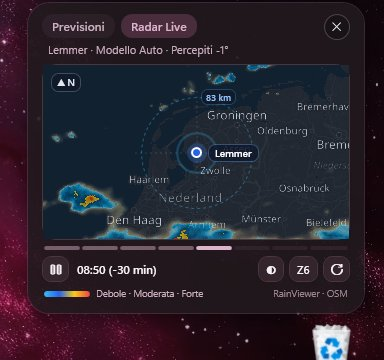

# Dsk.Weather — Desktop Weather Widget for Windows 11


Widget meteo desktop nativo per **Windows 11** in stile **Material You** (*Riepilogo + Orologio + Allerte Meteo + Radar Precipitazioni Live*), sviluppato in **C# .NET 8 WPF**, 100% gratuito, open-source, senza dipendenze NuGet di terze parti, senza API key a consumo e a carico GPU LLM zero.

---

## Anteprima



---

## Funzionalità Principali (`v1.6.0`)

- **Integrazione nativa sul Desktop:** ancorato sul livello desktop (`DesktopPinned`, o `AlwaysOnTop` / `BottomMost` a scelta), con geometria fissa compatta (`338 px` sia per Card che per Drawer), nascosto dalla taskbar e da `Alt + Tab`, con protezione automatica della visibilità dopo `Win + D` (*Mostra Desktop*).
- **Material You & Atmosfera Dinamica:** estrae automaticamente il colore dominante dallo sfondo attivo di Windows (con fallback sull'accento DWM) e applica una sfumatura discreta adattata a meteo e fascia oraria (inclusa golden hour) sia alla Card che al pannello espandibile Previsioni / Radar.
- **Animazioni Meteo Volumetriche Procedurali (30 FPS):** motore atmosferico nativo `Pbgra32` (`ProceduralAtmosphereFactory`) con texture congelate (`.Freeze()`) in cache: **nuvole fBm volumetriche seamless su 2–3 strati in parallasse**, **fasci di luce crepuscolare (god rays)** + particelle bokeh dorate per il sole, **nebbia organica** in contro-scorrimento, **pioggia e neve bokeh su 2 piani di profondità**, e **sheet lightning** dentro i banchi nuvolosi con scarica elettrica ramificata per i temporali (disattivabile dalle Impostazioni).
- **Riepilogo *"At a Glance"* deterministico:** analizza le prossime 12 ore per segnalare temporali, pioggia in arrivo, vento sostenuto, nebbia, UV alto o cali termici.
- **Allerte Meteo Ufficiali (Giallo / Arancione / Rosso):** badge a vetro semitrasparente accanto all'orologio + banner descrittivo nel pannello Previsioni alimentati dai servizi meteorologici e di protezione civile nazionali ufficiali (**Dipartimento della Protezione Civile** per Comune esatto in Italia, **DWD / Bright Sky** per la Germania, **NOAA NWS** per gli USA, **IPMA** per il Portogallo, **MET Norway** per la Norvegia, ed **EUMETNET MeteoAlarm CAP 1.2** solo nei Paesi EU con granularità provinciale/poligonale), con test **Point-in-Polygon / Haversine**, ciclo vita **`Alert -> Update -> Cancel`**, cache **stale-while-error** (`Live` / `StaleCache` / `Fallback`) e fallback persistente (>= 2h consecutive) su Open-Meteo fuori copertura; **invisibile quando il tempo è neutro**.
- **Striscia Oraria 24 Ore Scorrevole + 3 Curve Indipendenti + Tramonto/Alba (Tutti i Layout):** disponibile su tutti e 3 i layout (*Card Completa*, *Minimal Trasparente* con testo e curve ad alto contrasto ed effetto ombra su desktop trasparente, *Material Compatto* con spaziatura raccolta), scorribile fluidamente con rotellina del mouse o trascinamento e con barra di scorrimento discreta visibile solo al passaggio del mouse. La striscia 24h è attivabile separatamente dalle sue **3 curve Bézier indipendenti** (**Curva Termica `°`**, **Curva Precipitazioni `%`** con scala 0–100 e **Curva Umidità `%`**) complete di legenda automatica e **slot dedicati per Tramonto e Alba** all'orario esatto.
- **Previsioni 7 Giorni:** tabella settimanale nel pannello espandibile con formato data `Lun 23`, gocciolina + `% pioggia`, triangolino direzionale del vento + `km/h`, e `Min° / Max°`.
- **Radar Precipitazioni Live OpenStreetMap:** scheda dedicata **Radar Live** su mappe **OpenStreetMap** senza watermark, con passaggio **automatico alba/tramonto** tra modalità **diurna chiara** e **notturna scura** (più switch manuale `◐`), 4 livelli di zoom `Z5–Z8` anche tramite rotellina del mouse, anello di portata in `km`, onda sonar sul pin città e timeline 8 fotogrammi **RainViewer** con cross-fade (`0%` CPU a pannello chiuso).
- **Posizioni Preferite, Rilevamento Automatico (IP) & Cambio Rapido 1-Click:** salva più località preferite nelle Impostazioni (senza mostrare coordinate superflue nell'interfaccia, con protezione dell'ultima città salvata) e alterna istantaneamente tra di esse con **1 click** direttamente sulla riga località della card (o dal menu tasto destro), oppure attiva **Posizione automatica (rete / IP)** con rilevamento a cascata **GeoJS → fallback `ipwho.is`** e localizzazione del Paese.
- **Finestra Impostazioni Material You & Multilingua (6 Lingue):** pannello floating arrotondato sincronizzato live con la palette attiva del widget, completo di switch a pillola, slider custom, pulsante diretto per chiudere completamente il widget dalla sezione Windows e **selettore lingua live** (*Italiano, English, Deutsch, Nederlands, Español, Português*).
- **Motore Meteo Ad Alta Precisione + Ripresa Automatica:** utilizza automaticamente il profilo ad alta precisione `best_match` su **Open-Meteo** (modelli locali ad alta risoluzione fino a 2 km + ECMWF IFS con indice UV e raffiche completi), salvataggio atomico con retry + debounce e ripresa automatica dopo standby o ripristino rete.

---

## Requisiti & Avvio Rapido (Windows 10 / 11)

- **Requisito:** [Microsoft .NET 8 Windows Desktop Runtime (x64)](https://dotnet.microsoft.com/download/dotnet/8.0)

Per avviare il widget senza finestra console e senza falsi positivi euristici dell'antivirus sugli eseguibili auto-estraenti non firmati, usa il launcher incluso che esegue `Dsk.Weather.dll` tramite l'host ufficiale firmato Microsoft `dotnet.exe`:

```text
Avvia-DskWeather.vbs
```

Oppure da PowerShell (dalla root della repo):

```powershell
.\scripts\Launch-DskWeather.ps1
```

Per gestire l'avvio automatico con Windows:

```powershell
.\scripts\Toggle-Autostart.ps1 -Enable   # oppure -Disable / -Status
```

---

## Compilazione, Test & Publish da Sorgente

```powershell
# Compilazione intera solution (App + Test)
dotnet build Dsk.Weather.sln -c Release

# Esecuzione suite test unitari deterministici (34/34 check)
dotnet tests\Dsk.Weather.Tests\bin\Release\net8.0-windows\Dsk.Weather.Tests.dll

# Pubblicazione pacchetto finale in dist\
dotnet publish src\Dsk.Weather\Dsk.Weather.csproj -c Release -r win-x64 --no-self-contained -o dist
```

---

## Fonti Dati & Privacy

L'app non raccoglie telemetria né richiede account o chiavi API. Impostazioni e cache meteo restano esclusivamente in locale (`%LocalAppData%\Dsk.Weather\`).

- **Meteo & Geocoding:** [Open-Meteo](https://open-meteo.com/) (CC BY 4.0)
- **Allerte Meteo Ufficiali:** [Dipartimento della Protezione Civile (Open Data)](https://github.com/pcm-dpc/DPC-Bollettini-Criticita-Idrogeologica-Idraulica) (Italia per Comune esatto, CC BY 4.0), [DWD / Bright Sky](https://brightsky.dev/) (Germania), [NOAA National Weather Service](https://www.weather.gov/documentation/services-web-api) (USA), [IPMA Open Data](https://api.ipma.pt/) (Portogallo), [MET Norway MetAlerts](https://api.met.no/weatherapi/metalerts/2.0/documentation) (Norvegia), [EUMETNET MeteoAlarm](https://www.meteoalarm.org/) (Paesi EU con granularità provinciale/poligonale), risoluzione amministrativa [Nominatim OSM](https://nominatim.openstreetmap.org/)
- **Geolocalizzazione IP (primo avvio / modalità automatica):** [GeoJS](https://www.geojs.io/) con fallback [ipwho.is](https://ipwho.is/) e nomi località via [Nominatim OSM](https://nominatim.openstreetmap.org/)
- **Radar Precipitazioni:** [RainViewer](https://www.rainviewer.com/)
- **Mappa Base Radar:** [OpenStreetMap](https://www.openstreetmap.org/copyright) (© OpenStreetMap contributors)

---

## Licenza

Distribuito sotto licenza **MIT**. Vedi [LICENSE](LICENSE) per i dettagli.
